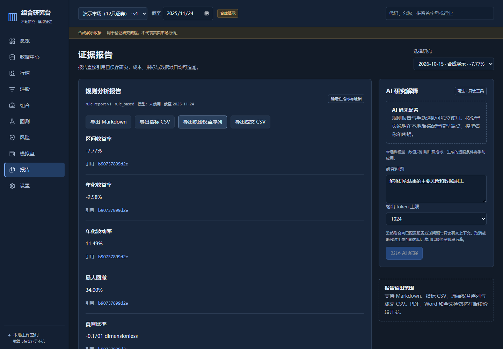

# QuantAI · 股票组合研究客户端（初版归档）

一个以本地数据为基础的股票研究工作台，覆盖 **数据导入 → 条件选股 → 组合配置 → 回测 → 模拟交易 → 报告导出**。

本目录保存 2026-10-15 已验收的 **M0 / v0.1.0 初版源码**。原独立项目提交：`c2370b2e9128fba084c4984ae584080562366b72`。后续与旧 QuantAI 的模型、RAG 和行情下载能力合并，在另一个本地开发目录进行；本归档不包含尚未验收的合并功能。



## 已实现功能

- **数据中心**：CSV 编码与中文表头识别、字段映射、错误行预检、成交量单位转换、独立交易日历和固定数据版本；另有明确标注的合成演示数据。
- **行情与选股**：代码、名称、拼音首字母搜索，历史日线和技术特征，条件筛选、筛选漏斗与方案保存。
- **组合与风险**：等权、波动率倒数、最小方差配置，权重与现金约束，历史风险指标与集中度分析。
- **回测与模拟盘**：共用费用、撮合和账本规则；支持固定目标权重调仓、T+1、资金冻结、幂等请求、事务回滚、审计核验与账户持久化。
- **报告**：保存数据、日历、引擎和费用版本及缺口，导出 Markdown、指标 CSV、权益序列和成交记录。
- **客户端**：Svelte 页面、FastAPI 本地服务和 Tauri 原生桌面壳，包含构建脚本和依赖锁文件。
- **可选 AI**：兼容模型服务的流式解释与受校验的自然语言选股条件；本初版未配置、未验收真实模型服务。

## 从源码运行

推荐 Windows，安装 Python 3.12、Node.js 24 和 PowerShell 7。以下命令在**本目录**执行，使用项目独立环境，无需作者机器上的开发目录或模型：

```powershell
py -3.12 -m venv .venv
.venv\Scripts\python.exe -m pip install -r apps/api/requirements.lock
.venv\Scripts\python.exe -m pip install --no-deps -e apps/api
npm.cmd ci --prefix apps/client
pwsh -File scripts/dev.ps1
```

如果没有 Windows `py` 启动器，用自己的 Python 3.12 可执行文件代替第一条命令。开发入口启动本地后端和浏览器页面；Ctrl+C 停止自己启动的进程。运行数据保存在 `runtime/`，不随源码上传。

首次运行可在“数据中心”生成合成演示数据体验完整流程，或导入自己的行情与真实交易日历 CSV。行情必需列示例：

```csv
code,date,open,high,low,close,volume
000001,2026-01-05,10,11,9,10.5,100000
```

交易日历为单列 `date`，行情文件中的成交量需要明确选择“股”或“手”。示例行只展示格式，不代表真实市场价格。

## 验证与构建

```powershell
# 源码检查；含后端测试、类型、契约及前端检查 / 测试 / 静态构建
pwsh -File scripts/check.ps1 -SkipE2E

# 完整浏览器流程；需本机 Edge 或 Playwright Chromium
pwsh -File scripts/check.ps1

# 自行构建便携客户端
pwsh -File scripts/build.ps1 -PortableOnly
```

自行构建 Tauri 安装包还需要 Rust 1.99.0 MSVC、Visual Studio C++ Build Tools 和 Windows SDK，再运行 `scripts/build.ps1`。原生运行使用 WebView2。便携构建入口在浏览器展示页面，原生安装包使用独立窗口。

本次只上传源码，没有发布新的安装包或 GitHub Release。原初版验收记录为后端 164 项、前端 45 项测试通过，另有源码 / 冻结服务端到端及原生窗口验收；本次归档前重新运行后端 164 项通过。历史证据、限制与性能口径见 [验收记录](docs/acceptance.md) 和 [性能记录](docs/benchmark.md)。远程 CI 结果以 GitHub 实际运行状态为准。

## 架构

```text
apps/api/src/portfolio_client/
  domain/          市场、策略、费用、撮合和账本规则
  application/     数据、组合、回测、模拟盘、报告和 AI 用例
  infrastructure/  SQLite、CSV、文件、后台任务及模型适配
  api/             HTTP 校验、鉴权和类型化接口
apps/client/       Svelte / TypeScript 页面与 Tauri 桌面壳
contracts/         OpenAPI 契约与生成类型的来源
scripts/           开发、检查、备份与构建入口
docs/              需求、设计、验收和功能追踪
```

框架与存储不进入领域规则；页面不重复计算费用或收益。金额使用 Decimal，交易使用原始价格，研究绑定显式时点、日历和数据版本。

## 范围与后续合并

初版以本地 CSV / 演示数据为入口，**尚无在线行情下载、RAG、实时分时、完整概率预测、实盘下单或团队平台**。回测使用固定目标权重与保守日线撮合；支持市场及公司行动等具体边界见验收记录。不能以演示或合成样本成绩证明真实投资收益。

后续合并计划包括在线与 CSV 双入口、日内 / 日线 / 中长期模式、云端 / Ollama / GGUF 模型中心、LangChain / LangGraph、资料检索与可追溯报告。以上为开发方向，不是本归档已实现功能；合并版先在本地验收，未获用户新的发布授权前不上传、不打包。

归档不含 `.venv`、`node_modules`、调试 / 压测数据、缓存、日志、数据库、持仓、API Key、模型权重、构建产物或安装包。保留必要的回归测试、维护脚本、依赖锁和合成样例，以便复现与维护。

软件许可证尚未确定，本目录不擅自授予额外的软件使用或再发布许可。
