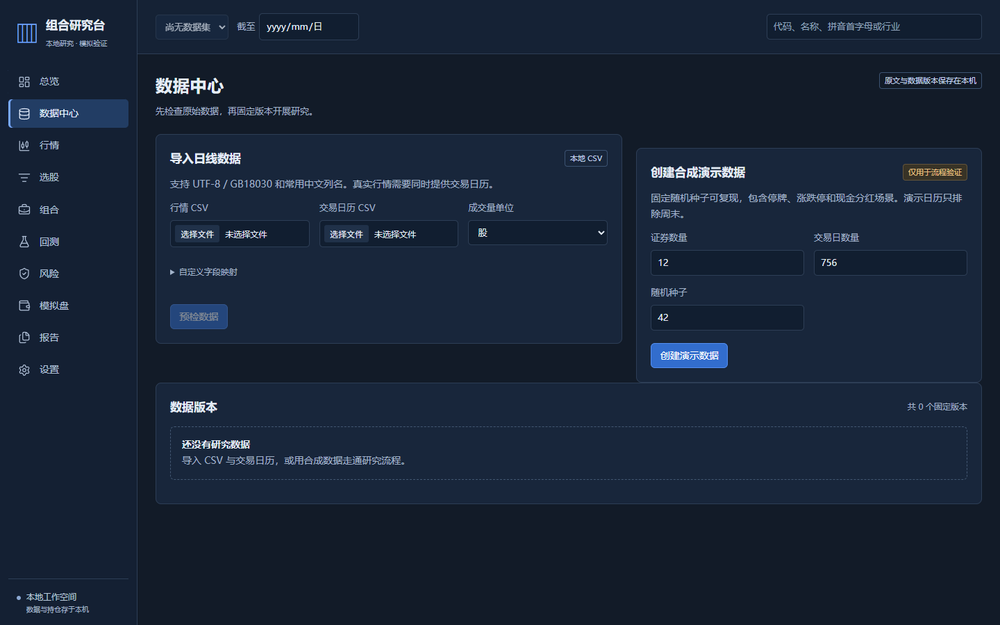

# M0 本地验收记录

日期：2026-10-15。范围为已批准的 14 项 M0 计划，原始 124 条需求仍按阶段保留。这里区分可运行功能、外部服务配置和原生桌面验收。

| 交付项 | 当前状态 | 证据与边界 |
| --- | --- | --- |
| 数据 / 行情 / 筛选 / 组合 / 回测 / 风险 / 模拟 / 规则报告 | 已实现并验证本地核心闭环 | 真实 HTTP、SQLite 和 Edge 浏览器流程；源码及冻结研究服务均已运行 |
| Windows 便携客户端 | 已构建并运行研究闭环 | PyInstaller onedir，运行时自带 Python 与静态页面；不是 Tauri 安装包 |
| Tauri 原生 WebView 壳 | 编译、安装和实际窗口验收通过 | Rust 1.99.0 格式 / 类型检查、发布构建、NSIS 当前用户安装；真实 WebView2 窗口、鉴权、外部导航拒绝和关闭清理均已验证 |
| WebView2 | 已安装 | Tauri info：155.0.4283.45 |
| 可选 AI | 适配与测试完成，真实服务未配置 | provider / transport 受控测试，未发生真实模型调用；不把模拟响应视为外部接入验收 |
| 远程 CI / GitHub 输出 | 配置已准备，未远程运行 / 未上传 | 用户尚未选择仓库，所有项目输出保留本地 |
| M1–M3 原需求 | 未实现或仅有基础子集 | 以 FR 追踪为准，不因存在页面或 API 就算原需求通过 |

## 源码检查

验收入口：`pwsh -File scripts/check.ps1`。独立评审修复后的完整命令返回 0：后端 **164 项**通过（`-W error`），Ruff 通过，mypy **102 个源码文件**通过，生成契约无漂移；前端 **45 项 / 21 个文件**通过，Svelte 检查 0 错误 / 0 警告，ESLint / Prettier 与静态构建通过。新增测试包括以下边界：

- CSV 编码、错误行、前导零、映射、真实日历与来源版本；原始 CSV 导出保留 `9007199254740993` 股和 `10.123456789` 元的原值。
- 公开历史与系统回放的可见性；不足窗口、NaN / Infinity、空值和零波动。
- 独立费用与收益预期、T+1、资金冻结、分红应收 / 支付、整股与容量限制、开盘涨跌停和周期末下一交易日。
- 同键并发、409 冲突、事务故障回滚、重启恢复、审计链与业务投影篡改。
- 任务进度 / 取消竞态、CLI 动态端口、鉴权、非法 Origin、静态路径隔离、数据目录独占锁与父进程退出清理。
- 未来数据库版本不创建旧表、不改变数据和 journal mode；备份恢复保留账户、审计链和原始文件。
- AI 无配置、超时、非法 DSL、伪造数值 / 引用、Unicode 数字、输出预算、取消、重放、重启与重复用量压缩；前端断线只查询原运行，切换上下文丢弃旧响应。

前端检查包括 TypeScript / Svelte 严格检查、ESLint / Prettier、Vitest 和静态构建。ECharts 与绘图运行库分块延迟加载；采样只作用于绘图，导出从后端原始记录生成。

## 端到端场景

`apps/client/e2e/` 使用独立临时目录、随机本机会话、真实 SQLite / 后端和实际静态产物。

1. 合成数据 → 刷新 → 筛选 → 组合 → 回测 → 报告下载 → 模拟下单 / 推进 → 刷新 → 审计核验。
2. 带 BOM 的 CSV 错误行预检 → 禁止提交 → 修正导入 → 筛选 / 组合 / 回测 → 来源证据报告 → 刷新恢复。
3. 200 标的三年样本 → 取消后台研究 → 非法短窗口错误显示与诊断编号。

源码服务三条场景全部通过，耗时 30.8 秒；冻结 EXE 三条场景全部通过，耗时 34.6 秒；场景一包含实际最小方差优化。冻结 EXE 使用同一套 E2E 场景验证，并从随附运行时加载页面，不借用源码静态目录。测试不包含真实行情、真实资产、券商或付费模型。

## 原生桌面验收

最初 `cargo check` 实际因缺 `link.exe` 失败；用户随后明确授权安装微软工具链。官方安装器数字签名为 Microsoft Corporation / Valid，安装返回 0，Build Tools 17.14.42、MSVC 14.44.35207、Windows SDK 10.0.26100.0 已安装完整且无需重启。Rust 1.99.0 仍使用项目缓存。

`cargo fmt --check`、`cargo check --locked`、发布构建及 NSIS 打包通过。NSIS 官方下载曾超时，使用官方资产摘要和 Tauri 内置摘要校验后填充项目 `target/.tauri` 缓存；再次打包成功。库目标重命名为 `portfolio_research_lib`，消除了库 / 可执行程序的 PDB 文件名冲突。

安装器按当前用户范围、默认 `%LOCALAPPDATA%\组合研究台` 安装，验收使用 `/S /NS` 跳过快捷方式。本次 Codex MSIX 环境将 LocalAppData 重定向，实际安装入口为 `C:\Users\chunmo\AppData\Local\Packages\OpenAI.Codex_2p2nqsd0c76g0\LocalCache\Local\组合研究台\portfolio-research.exe`；验收启动的是该解析后的实际文件。真实窗口通过以下检查：研究总览与数据中心可见；调用原生连接命令后 `/v1/config` 返回 200 / local；只启动一个自有研究服务；浏览器存储无凭证；外部导航被拒绝；页面错误为 0；正常关闭窗口后主进程返回 0，后端进程退出且监听端口关闭。验收未导入个人数据，使用本机新建的空工作空间。

安装完整性另行验证：裸发布程序与 NSIS 安装程序的长度一致，唯一差异是 Tauri 的包类型标记由 `__TAURI_BUNDLE_TYPE_VAR_UNK` 变为 `__TAURI_BUNDLE_TYPE_VAR_NSS`（3 个字节）。两种标记各出现一次，仅还原该标记后其余字节完全一致。安装目录中的 434 个当前运行时文件与构建产物逐项 SHA256、文件集合一致。重复测试安装遗留的 18 个旧版哈希命名 JavaScript 文件已在解析后限定的程序资源目录内逐个清除；未清理用户工作空间或数据。清理后再次验证实际窗口及关闭流程通过。

[微软工具链与 Rust 前置条件](https://v2.tauri.app/start/prerequisites/)、[Tauri CSP](https://v2.tauri.app/security/csp/)与[配置参考](https://v2.tauri.app/reference/config/)是实现依据。Windows CI 明确使用 Windows 2025、Rust 1.99.0 MSVC、Python 3.12.14、Node 24.19.0；远程工作流尚未运行，不写成已通过。

## 功能边界

- 回测是固定目标权重策略，按日 / 周 / 月 / 年形成调仓信号；不包含动态重选股、走步验证或多策略横向对比。
- 优化支持等权、波动率倒数、收缩协方差最小方差与单股上限 / 现金预算；不包含完整风险平价、BL、HRP 或风格自动匹配。
- 风险支持历史 VaR / CVaR、回撤 / 波动 / 夏普、证券 / 行业 / 现金 / 应收敞口；风险页固定 244 日年化。基准使用原始价格收益，缺日期不补零。
- 模拟执行使用沪深 100 股整手规则及保守开盘模型；科创板 / 北交所明确拒绝。无实盘或盘中撮合、自动日结、全局多策略熔断。
- CSV 暂无公司行动导入；合成与领域测试覆盖公司行动账本，真实导入的相应缺口持续显示。分红税前计入，未处理持有期红利税。
- 规则报告从持久化研究重建，带版本与证据；暂无历史报告版本差异、PDF / Word 或 AI 段落导出。
- 收藏 / 标签 / 标注、观察池、实时调权联动预览和专门跨周期对比页尚未提供；对应原 FR 即使初始阶段目标写 M0，也明确保持部分状态。

便携 ZIP 的启动脚本、完整运行时文件集合与 SHA256 均经过核对，未包含数据库、来源文件、密钥或开发环境。最终源码 / 便携 / 原生安装包的字节数和 SHA256 随交付写入本地 `dist/output-manifest.json`。

实际 ZIP 在中文 / 空格目录中、仅 Windows 系统 PATH 下解压启动通过；内置页面、鉴权、Origin、920 解析修复及父管道退出均通过。

独立评审完成，无 Critical、两项 Important 已按先失败后通过修复，没有延后 Minor；详见 [评审与修复](code-review.md)。本次不合并远程分支，不创建 GitHub 仓库或 PR。
